# 2022 年末以来的黄金上涨：利率、央行与投资需求

2022 年末，美元走弱、美国实际利率回落，金价随之反弹。此后的上涨还伴随着央行持续购金、亚洲金条金币需求增长，以及到 2025 年才明显扩大的黄金 ETF 净流入。

更新于 2026-11-25 · 数据截至 2026-03-31

## 2022 年末，金价为何随美元和利率转向

黄金不付利息，持有黄金的机会成本是美元利率，美国国债收益率上升会使黄金承压。美元也会影响黄金的购买成本。在美元金价相同的情况下，美元升值会让持有其他货币的买家付出更多本币。

2022 年的大部分时间里，市场不断上调对美联储这轮加息最高点的预期。下图记录了利率期货隐含的加息终点。到 11 月，市场一度预期利率会升至约 5.2%，随后预期略有回落。

从 2022 年 10 月到 2023 年 1 月，美国十年期实际收益率月均值从 1.59% 降至 1.29%，贸易加权的广义美元指数也从 127.5 降至 119.8。同期，黄金月均价从每金衡盎司 1,664 美元回升到 1,898 美元。下图把利率和美元的右轴倒置，并调整了显示比例。两条线一起上行，表示金价上涨、另一项指标下降；线条靠得多近取决于刻度。

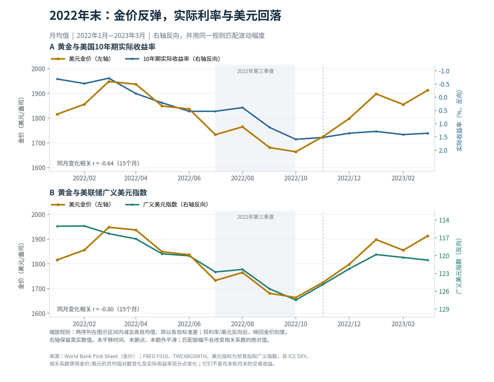

两项指标同时回落，很难仅凭走势分清各自的作用。世界黄金协会用多个市场指标估算每月金价涨跌的来源。在其模型中，美元走弱对 2023 年 1 月的金价上涨贡献最大。灰色部分表示模型未能解释的涨跌，单凭这张图无法判断有多少来自央行买盘。

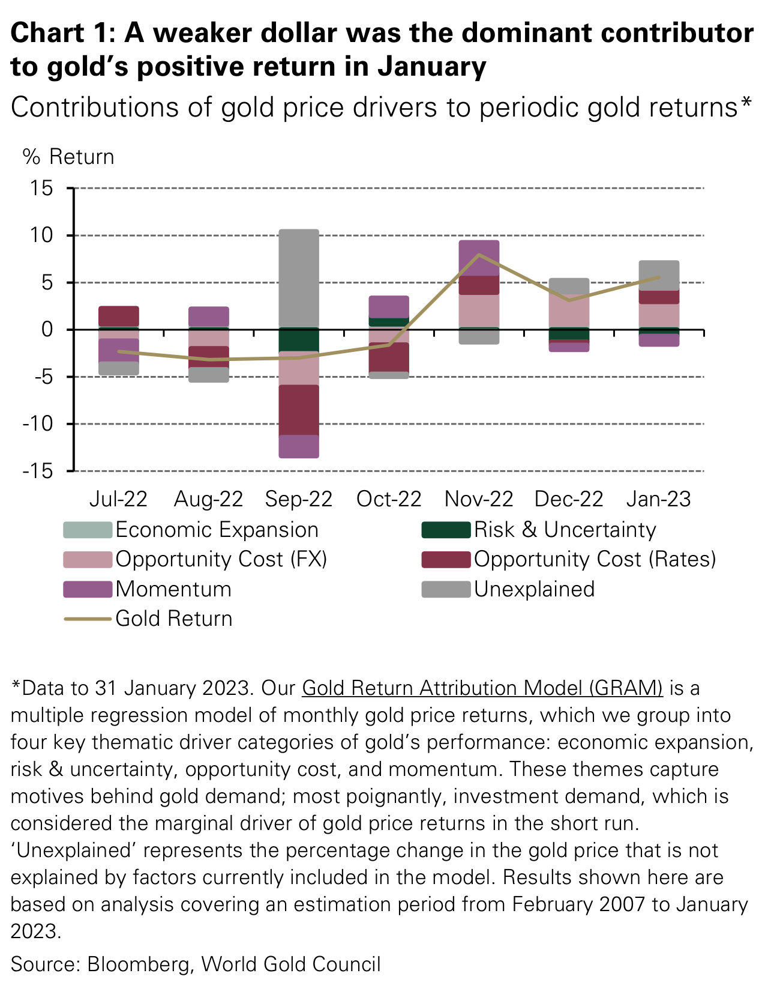

把时间拉长，利率能解释的行情就有限了。下图同样把实际收益率的刻度倒置。两条线在较早年份经常同向，但到 2024 年，实际收益率仍高，金价却已明显上行。这段分化使一个问题变得重要：在持有黄金仍需放弃较高利息的时候，哪些买家继续增加了黄金持仓？

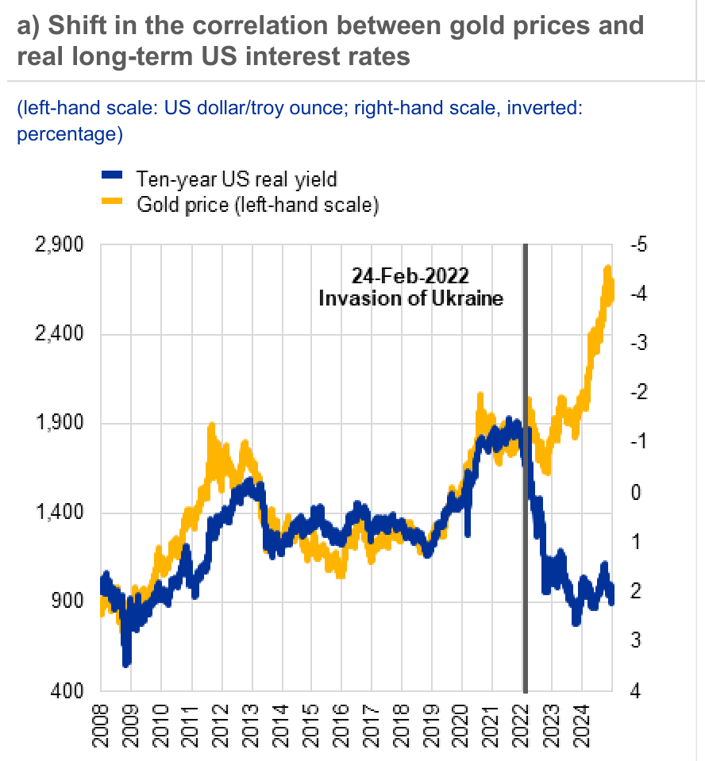

## 央行购金为何能持续数年

2022 至 2024 年，全球央行连续三年净购金超过 1,000 吨，明显高于此前多数年份。2025 年购金量回落，但仍高于 2010 至 2021 年的任一年。读图时可先比较蓝色柱子的高度，再看金色价格线。最右侧的 2026 年只包含第一季度，只能与各年柱底的浅蓝色部分直接比较。

从全球黄金需求构成也能看到这一变化。2022 年起，底部蓝色的央行需求占比明显高于前几年。到 2025 年，黄色的投资需求占比扩大，其中包括金条、金币和黄金 ETF。即使央行仍在大量购金，其他买家也会改变市场需求的构成。

央行持有黄金有多重理由。2024 年对 57 家持金央行的调查询问了哪些因素影响储备决策。长期保值和危机时期的表现都得到两组央行的普遍认可。图中黄色柱代表新兴及发展中经济体央行，其中提到制裁风险的比例更高。每根柱子表示选择该理由的央行比例，一家央行可以认可多个理由。

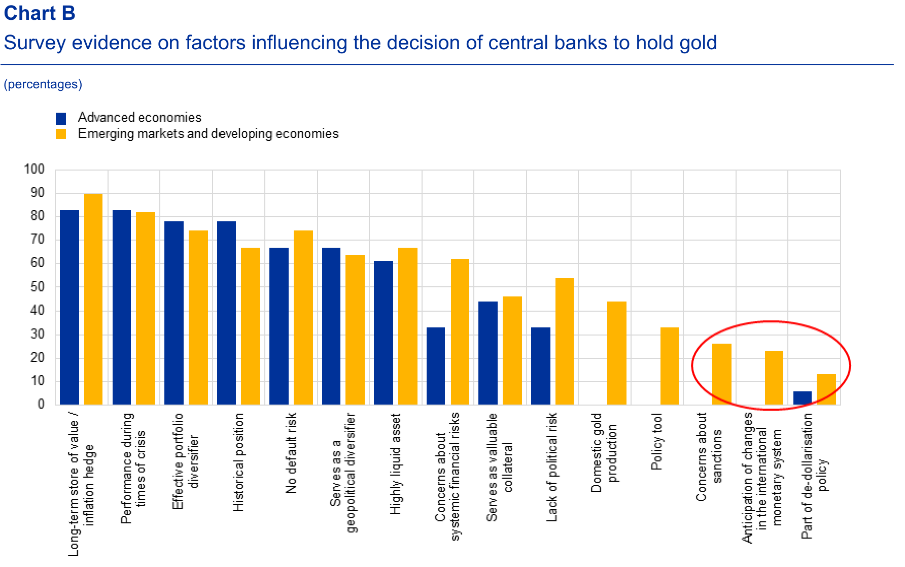

储备构成提供了另一个观察角度。在黄金储备占比增幅高于跨国平均值的国家中，2022 年政治立场相对更接近中俄的国家，黄金占比往往增加得更多。散点之间仍有很大差异，而且金价上涨本身也会抬高黄金在储备中的市值占比。因此，这张图只能描述所选国家的关系，无法据此推算各国因地缘政治而买入的吨数。

## 金条和金币的买家出现地区分化

2023 年，以人民币计价的国内现货黄金上涨约 17%，而沪深 300 和创业板指数均下跌。这为理解次年中国投资者对黄金的兴趣提供了背景。单看资产回报，还无法判断买金的钱来自哪一类资产。

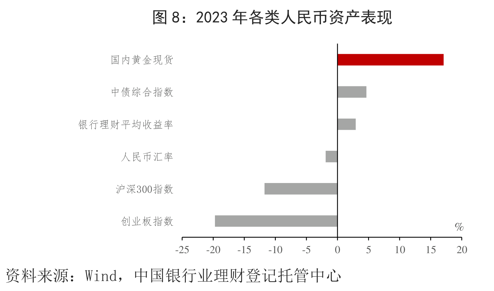

实物购买量给出了更直接的证据。2024 年，中国金条和金币投资量同比增加 20%，印度增加 29%，美国和欧洲则分别减少约 33% 和 50%。

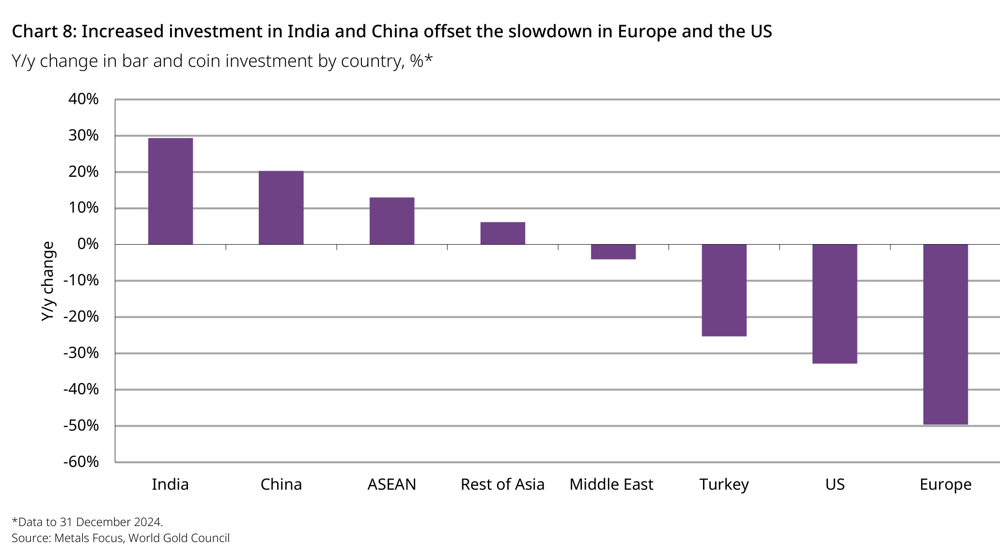

这些增减大致抵消，2024 年全球金条和金币需求总吨数与上年接近。下图中，各色柱子按左轴计量吨数，金色折线按右轴计量美元金额。当金价上涨时，即使售出的黄金重量相近，买家支付的总金额也会增加。

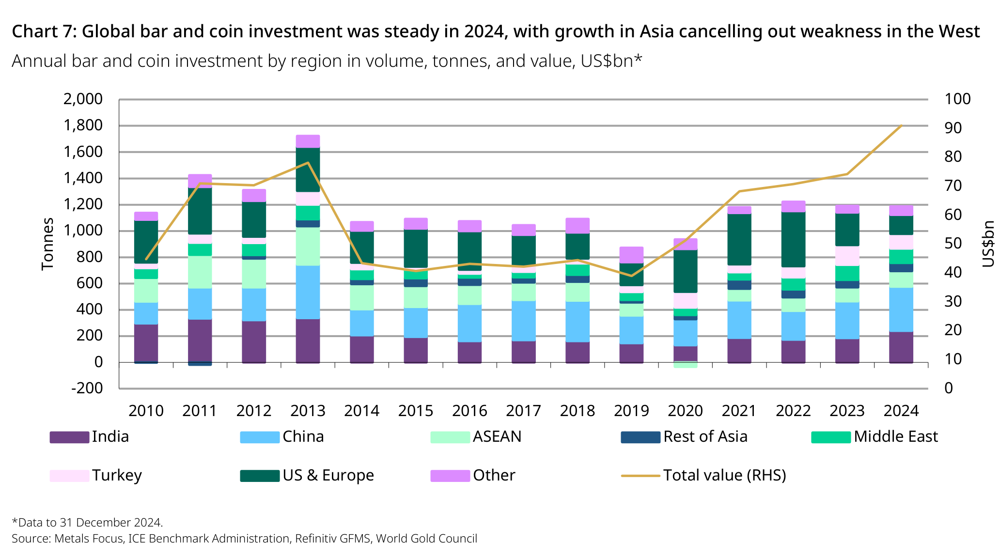

## 黄金 ETF 的买盘到 2025 年才明显扩大

黄金交易所交易基金（ETF）让投资者通过证券账户持有黄金敞口。衡量这类基金买入了多少黄金，可以看持仓吨数的净变化。2024 年上半年，全球黄金 ETF 合计净流出，下半年转为净流入。两个方向的变化几乎抵消，全年持仓变化很小。

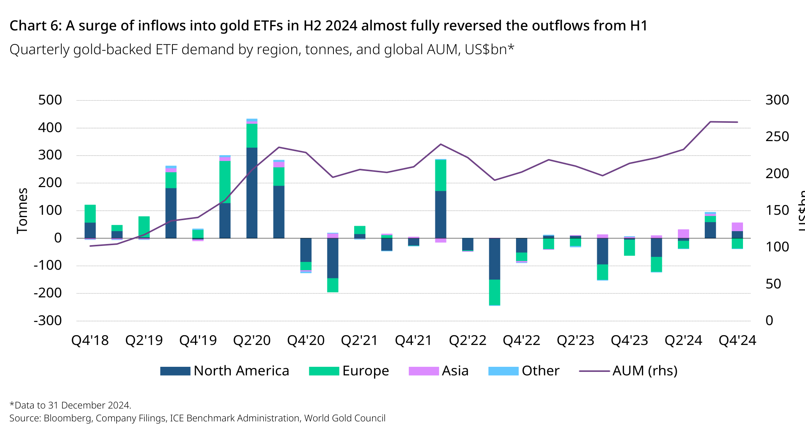

2025 年的买盘则持续到足以改变全年数字。全球黄金 ETF 持仓净增约 801 吨，上一年为净减约 3 吨。下图的柱子以吨计量净流量。金色折线表示基金资产的美元市值，这条线还会随已有持仓升值而上升。

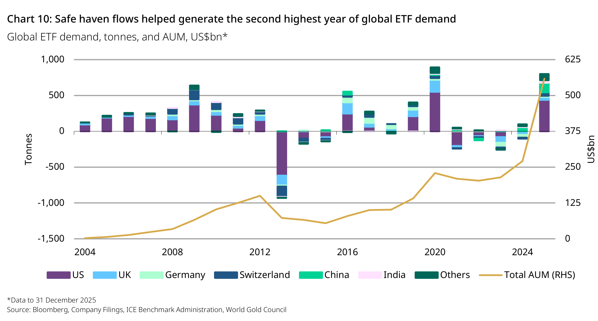

2025 年部分时段，围绕金价的网络搜索升温，部分黄金 ETF 的交易价格也高于其所持资产的每份净值。国际清算银行跟踪的基金样本还区分了散户和机构资金。右图中，黄金基金的散户累计净流入增加，机构资金的变化较小。这些数据能帮助辨认哪些投资者参与了基金买盘，覆盖范围限于样本内的基金。

## 避险需求取决于市场承受什么压力

历史上，黄金在多种压力环境下都有避险表现。欧洲央行按地缘政治风险、经济政策不确定性和股市波动等指标选出压力较高的时期，再把各类资产的平均收益除以其收益波动率。下图中，黄金的蓝色柱子在四组样本中均为正。同一指标下美元和长期美债的表现有所不同，“避险”并不保证这些资产总是同涨。

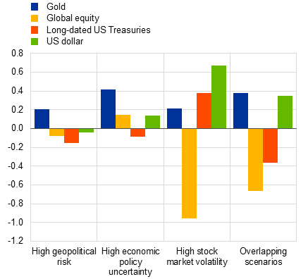

2025 年 4 月 2 日关税消息后的三个交易日就是一例。对照图中的蓝柱和黄点，历史避险事件后美国十年期国债收益率平均下降，这一次却上升。美元名义有效汇率在这三天仍小幅走高，升幅小于历史平均值。图中记录的是消息发布后的短期反应，时间范围只覆盖这三个交易日。

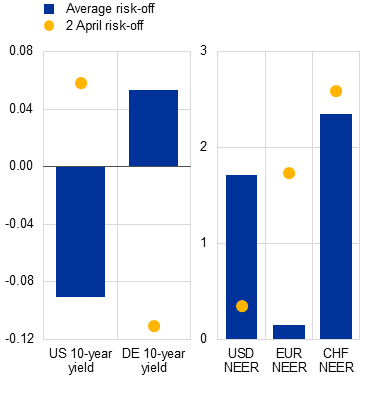

金融条件也会影响金价对地缘风险的反应。基于 1990 年至 2026 年 3 月数据的模型分别考察了地缘威胁和已经发生的事件。在资金较宽松的环境中，绿色曲线估计的黄金累计回报通常高于金融条件偏紧时的橙色曲线。阴影为 90% 置信区间，部分区间重叠，模型对两种环境之间差距的估计仍有不确定性。

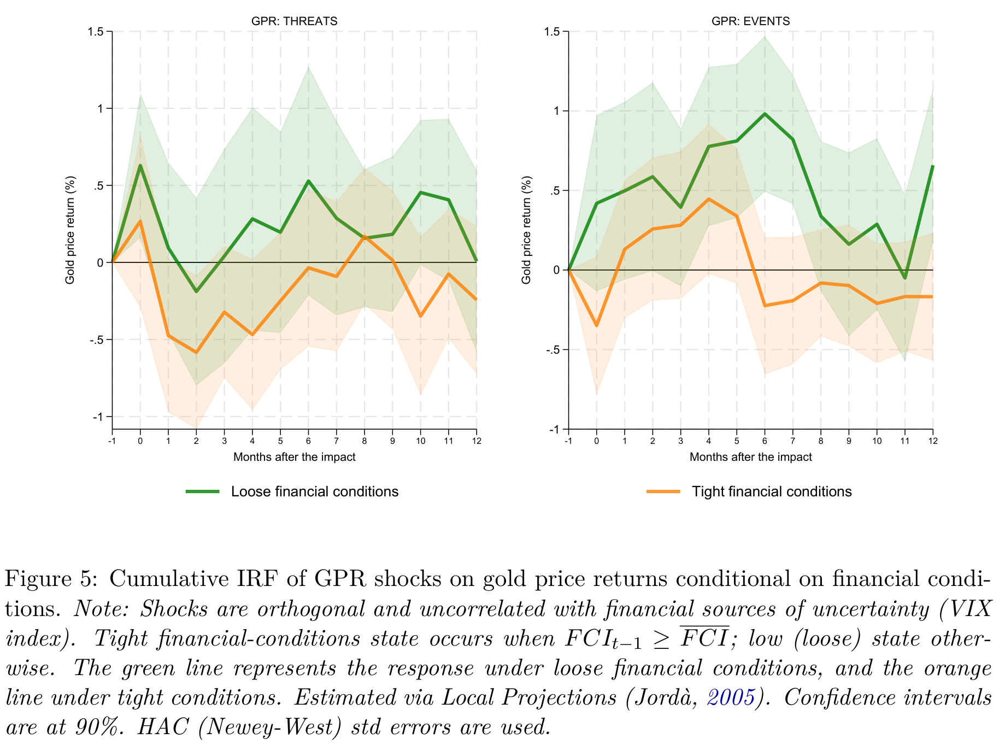

## 金价上涨后，回收金增加了多少

金价上涨会提高出售旧金饰等物品的变现价值，回收金因此是需求之外值得观察的供给来源。2025 年，美元金价年均值比 2024 年高约 44%，全球回收金却只从约 1,365 吨增至 1,404 吨，增幅约 2.9%。两条线用的都是同比变化率。这一年，回收供应确实增加了，但其增幅远小于价格涨幅。

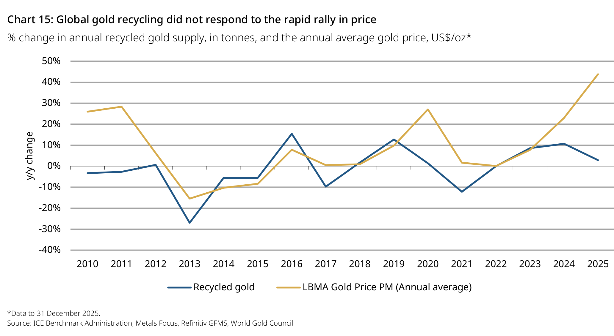
