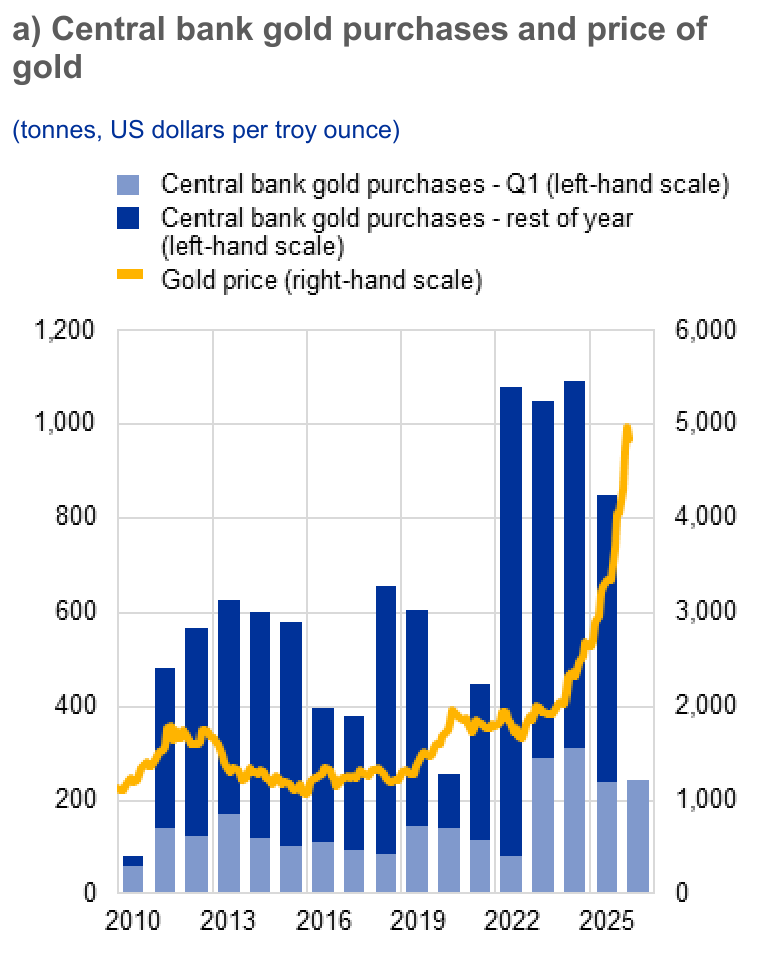
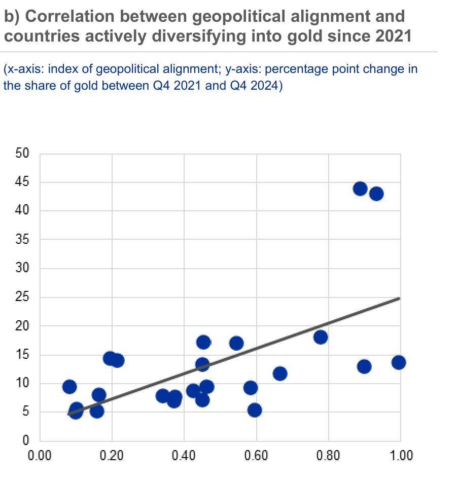
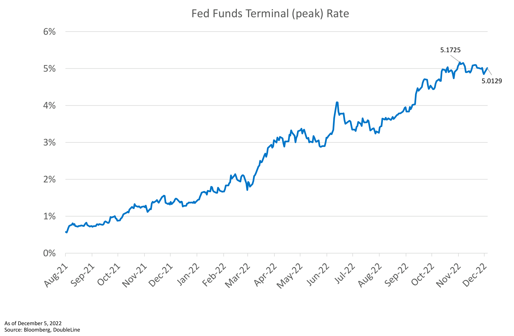
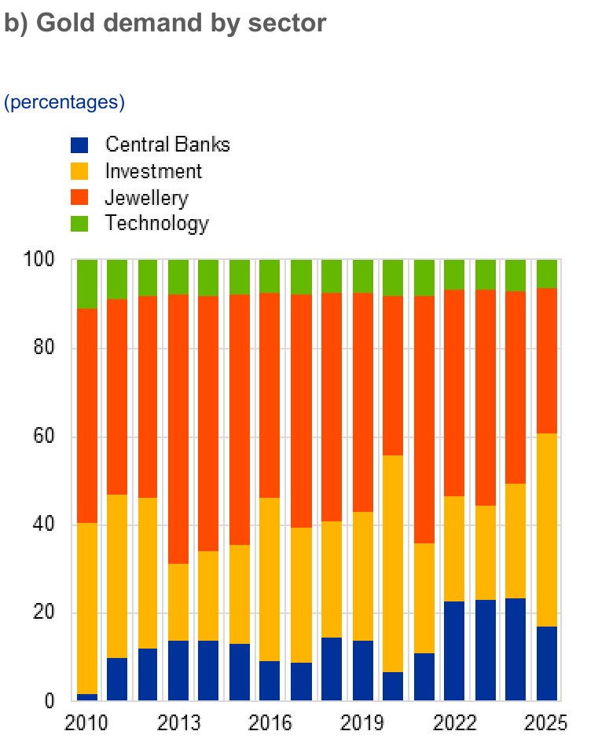
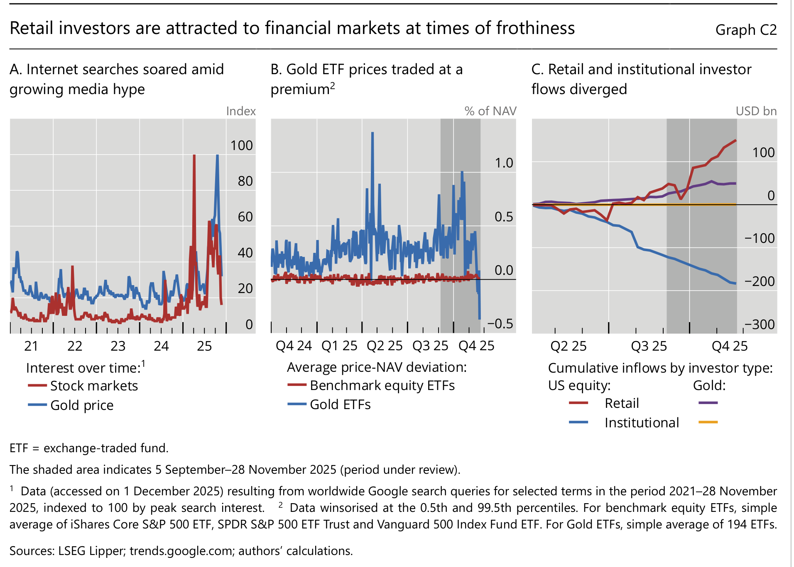

# 2022～2026 年黄金牛市分析

## 央行购金：2022年需求抬升，2025年购买量与价格分化

2022 年 2 月 24 日，俄罗斯全面入侵乌克兰，俄乌战争爆发。

- 战争爆发前，俄罗斯拥有充裕的国际储备：俄罗斯央行公布的数据是：2022 年 2 月 18 日，国际储备约为 6,432 亿美元，包括外汇资产、黄金等。
- 战争爆发后的 2 月 28 日，美国禁止美国主体与俄罗斯央行、财政部及国家财富基金开展相关交易；欧盟同期采取了限制俄罗斯央行交易的措施。受相关法律约束的金融机构不能正常执行俄罗斯央行的交易和资金调动指令。到当年 6 月，**约 3,000 亿美元的俄罗斯央行资产已无法调动**。
- 存放在本国金库里的黄金不依赖外国债务人兑现承诺

> 其实 2014 年起俄罗斯就已经开始增加黄金和人民币储备，为地缘政治危机缓冲。
> | 储备资产占比 | 2013 年末 | 2021 年末 |
> | --- | --- | --- |
> | 美元 | 41.6% | 10.9% |
> | 黄金 | 8.3% |21.5%|
> | 人民币 |	0 |	17.1% |

### 2022 年：

- 俄罗斯央行的海外储备受限给各央行敲响了警钟，强化了他们的黄金储备需求，表现为 2022 年以来央行购金量的显著增长。
- 但同期，美联储快速收紧政策，实际利率上升，美元走强，压制了黄金价格。
  - 2022 年三季度央行购金达 400 吨，黄金 ETF 却流出 227 吨，金价当季下跌 8%
- 因此，2022 年主要发生需求结构变化，持续上涨尚未发生

### 2022 年末至 2023 年初：

- 2022 年末，市场开始调整对美联储后续加息路径的判断，美元和美债实际收益率回落：广义美元指数下跌 6%，十年期国债实际收益率从 1.59% 下降至 1.29%
- 空头回补也推动了最初的反弹
- 但全球黄金 ETF 仍净流出 34 吨
- 2022 年 10 月至 2023 年 1 月，金价上涨 14%

### 2023 年：

- 3 月，美国银行业危机使黄金避险需求迅速上升，黄金 ETF 增加 32 吨。但整个第一季度 ETF 仍然净流出。
- 10 月，中东冲突推动了一次快速反弹。
- 2023 年国内黄金明显上涨，沪深 300 和创业板下跌，债券和理财回报较低，增强了黄金对中国投资者的吸引力。

### 2024 年：

- 2024年3月，金价单月上涨约8.1%。当月美元大体持平。世界黄金协会的当期分析强调，期货空头回补、新增多头，以及黄金自身的波动和动量因素，对上涨具有解释力。
- 2024年，中国和印度金条金币需求分别增长约20%和29%，美国和欧洲则明显下降。
- 9 月美联储降息 50 个基点
- 2024 年全年黄金上涨 26%

### 2025 年：

- 私人需求显著扩大
  - 2024 年黄金 ETF 净增持 -3 吨，2025 年则为 +801 吨，金条金币需求也从 2024 年的 1188 吨增长至 1374 吨
- 央行购金从 2024 年的 1092 吨减少 21%，至 863 吨
- 4 月特朗普关税冲击
  - 出现了美元贬值、美债收益率上升的组合，偏离了通常的避险模式。
  - 投资者配置黄金的动机增强
- 全年金价上涨 44%

### 2025 年末至 2026 年初：

- 黄金价格上涨本身成为买入理由，形成正反馈循环。
  - 2025 年 12 月，黄金相关搜索热度上升，黄金 ETF 出现溢价，散户流入增加

